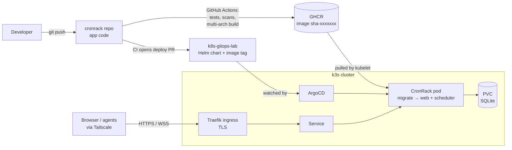

# k8s-gitops-lab

GitOps deployment repo for **CronRack**, a homelab monitoring platform I built, running on a
two-node **k3s** cluster at home. The app is packaged as my own **Helm** chart and deployed by
**ArgoCD**: a change merged into this repo is what reaches the cluster.

I built this to learn Kubernetes, Helm and ArgoCD hands-on, with a real application I use
every day instead of a demo app.

## Architecture



| Node | Hardware | Arch | Role |
|---|---|---|---|
| dimiserver | Old laptop, i3, 4 GB RAM, HDD | amd64 | k3s server (control plane) + worker, runs CronRack |
| diicpi | Raspberry Pi 4B, 4 GB RAM, microSD | arm64 | k3s agent (worker) |

Both nodes share a LAN for cluster traffic. Remote access (kubectl, browser, agents) goes
through Tailscale, and CronRack is served with a Let's Encrypt certificate for its Tailscale
MagicDNS name.

## Repository layout

```
apps/cronrack/      hand-written manifests (how I learned the pieces before Helm)
apps/podinfo/       first practice app
charts/cronrack/    the Helm chart ArgoCD deploys
  values.yaml       image tag, domain, storage, node placement, TLS
  templates/        PVC, ConfigMap, Deployment, Service, Ingress
argocd/             ArgoCD Application definition
```

## Delivery pipeline

1. A change is pushed to the **cronrack** app repo (private).
2. GitHub Actions runs linting, tests and security scans (Ruff, Bandit, pip-audit, gitleaks,
   pytest), builds an **amd64 + arm64** image, pushes it to GHCR tagged with the commit SHA,
   and scans it with Trivy.
3. A **promote** job opens a pull request here that changes one line: `image.tag`.
4. Merging that PR is the release. **ArgoCD** detects the new commit and syncs.
5. Kubernetes recreates the pod: the image is pulled, the `migrate` init container applies
   database migrations, then `web` and `scheduler` start.
6. A bad release is rolled back with `git revert`.

Manual changes to the cluster are treated as drift: ArgoCD runs with **self-heal**, so the
cluster always converges back to what is in this repo.

## Design decisions

| Decision                                          | Why                                                                                                                                                      |
| ------------------------------------------------- | -------------------------------------------------------------------------------------------------------------------------------------------------------- |
| Single replica, `strategy: Recreate`              | CronRack uses SQLite and keeps WebSocket and rate-limit state in memory, so two copies must never run at once. Scaling out would need Postgres and Redis |
| Init container for migrations                     | The schema always matches the code, a failed migration stops the rollout instead of breaking the app                                                     |
| `nodeSelector` pins CronRack to dimiserver        | The database lives on the HDD, not on the Pi's SD card                                                                                                   |
| PVC with `helm.sh/resource-policy: keep`          | The local-path reclaim policy is `Delete`; this stops `helm uninstall` from deleting the database                                                        |
| Namespace enforces Pod Security `restricted`      | Non-root UID, no privilege escalation, all capabilities dropped, seccomp, read-only root filesystem                                                      |
| Secrets created out of band, never committed      | Kubernetes Secrets are only base64-encoded                                                                                                               |
| Separate app and deploy repos, immutable SHA tags | Every deployment is a reviewable commit; CI never needs cluster credentials                                                                              |
| Least-privilege tokens                            | Image pulls use a read-only token; CI's deploy token can only push branches and open PRs in this repo                                                    |
| Agents run as systemd services, not a DaemonSet   | Inspecting the host from a pod would need privileged containers                                                                                          |

## Problems I hit and how I fixed them

- **k3s on the Pi:** Raspberry Pi OS disables the memory cgroup at boot. Kubernetes relies on
  it for memory limits, OOM handling and eviction, so I re-enabled it on the kernel command
  line.
- **Local test cluster broke after a reboot:** k3d nodes are Docker containers and came back
  with different IPs. Learned why node identity must be stable, and to stop/start the cluster
  cleanly.
- **ArgoCD stuck on `Unknown`:** the repo was private, so ArgoCD couldn't read it
  (`authentication required`).
- **"Synced" but the change wasn't there:** the commit was never pushed. Comparing ArgoCD's
  deployed revision with `git log` found it immediately.
- **Agent rejected the certificate:** the Ingress template had no `tls:` block, so Traefik
  served its self-signed default.
- **ArgoCD install failed on the Pi:** the first image pull (211 MB) took longer than Helm's
  default timeout. Diagnosed via pod events; reinstalled with a longer timeout.
- **Readiness probe failing at startup:** `connection refused` while the app was still
  booting on slow hardware. The probe kept traffic away until it was ready, as designed.

## What I learned

- How a manifest becomes a running pod: API server, controllers, scheduler, kubelet, containerd.
- Services, EndpointSlices and Ingress, and how a request reaches a pod.
- Why stateful apps limit scaling, and how storage outlives pods.
- Helm: templating, values, releases, upgrade and rollback.
- GitOps with ArgoCD: sync, drift detection, self-heal, rollback through Git.
- A troubleshooting routine: `get` → `describe` (events) → `logs --previous`.

## Status and next steps

- [x] Two-node k3s cluster (amd64 + arm64)
- [x] CronRack deployed via Helm chart and ArgoCD
- [x] TLS with a Let's Encrypt certificate via Tailscale
- [x] CronRack agents on both nodes
- [ ] CI promote job (built, rolling out)
- [ ] Add the GitHub CI scans on the k8s git ops repo
- [ ] Provision the nodes with Ansible, then rebuild from scratch to prove it
- [ ] Secrets via an external store (Vault or External Secrets Operator)
- [ ] Prometheus, Grafana and Node Exporter for cluster metrics
- [ ] Automate the 90-day certificate renewal
